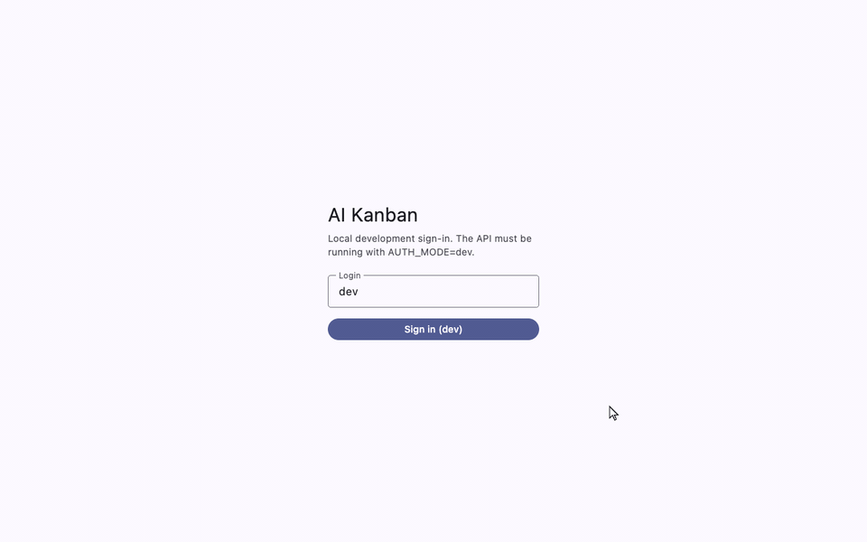
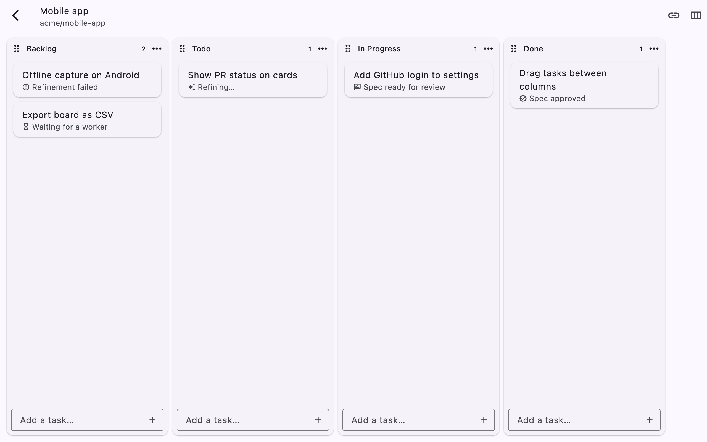
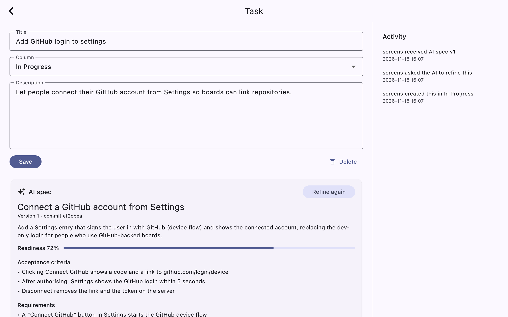

# AI GitHub Kanban

A Kanban board for GitHub that turns a short task brief into a detailed spec grounded in your repository.

<picture>
  <source media="(prefers-color-scheme: dark)" srcset="docs/architecture/structure-dark.png">
  
</picture>

## What it does

1. **Capture** a five-word task, from your phone or desktop.
2. **Refine**: an agent on your own machine reads the repository and writes a spec: requirements, acceptance
   criteria, the code it's grounded in, open questions and a suggested approach.
3. **Approve**: comment and ask for a revision, or approve it. Approval opens exactly one GitHub issue.
4. **Track**: PRs linked to that issue, with their reviews and CI status, show on the card.

**It doesn't write code.** Agents only read the repository; implementation stays with you and your team.

| Board | Spec ready for review | Phone |
| --- | --- | --- |
|  |  |  |

## Principles

- The backend owns tasks, specs and history; GitHub owns issues, PRs, reviews and CI.
- Agents are read-only, and repository content is treated as data, never as instructions.
- Jobs are recoverable: retries never create a second spec or a second issue.
- No secrets in clients.

## Stack

Flutter (macOS, Windows, Linux, web, iOS, Android) · TypeScript, Fastify and PostgreSQL · a worker daemon on your own
machine running OpenCode with DeepSeek, or Claude Code · a GitHub App.

## Get it

Download the signed macOS app from [Releases](https://github.com/chengboonrong/ai-kanban/releases/latest).

## Docs

- [Local development](docs/setup/development.md)
- [Running your worker](docs/setup/worker.md)
- [GitHub App setup](docs/setup/github-app.md)
- [Architecture](docs/architecture/overview.md)
