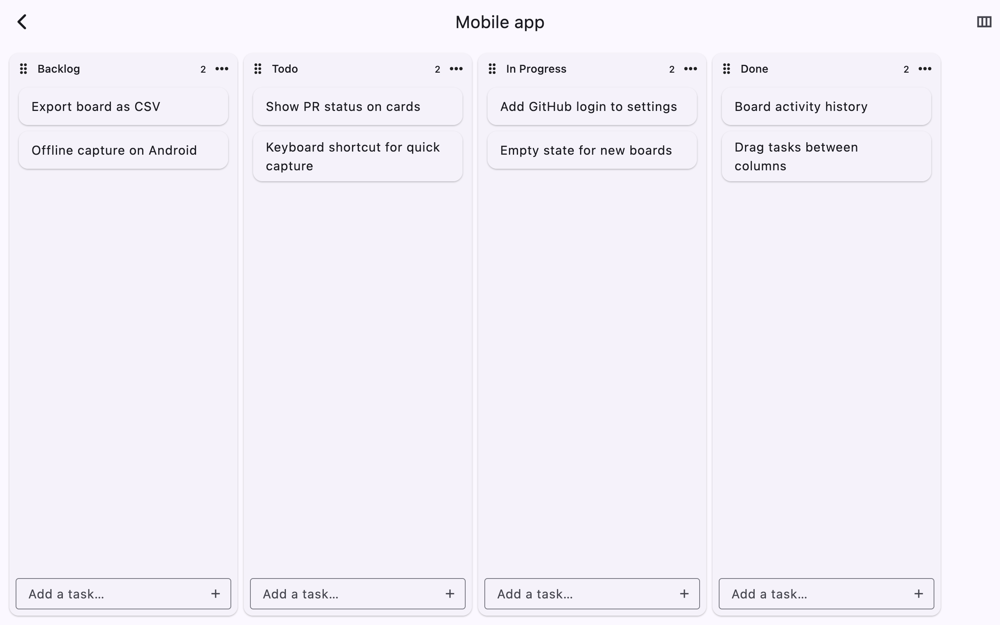
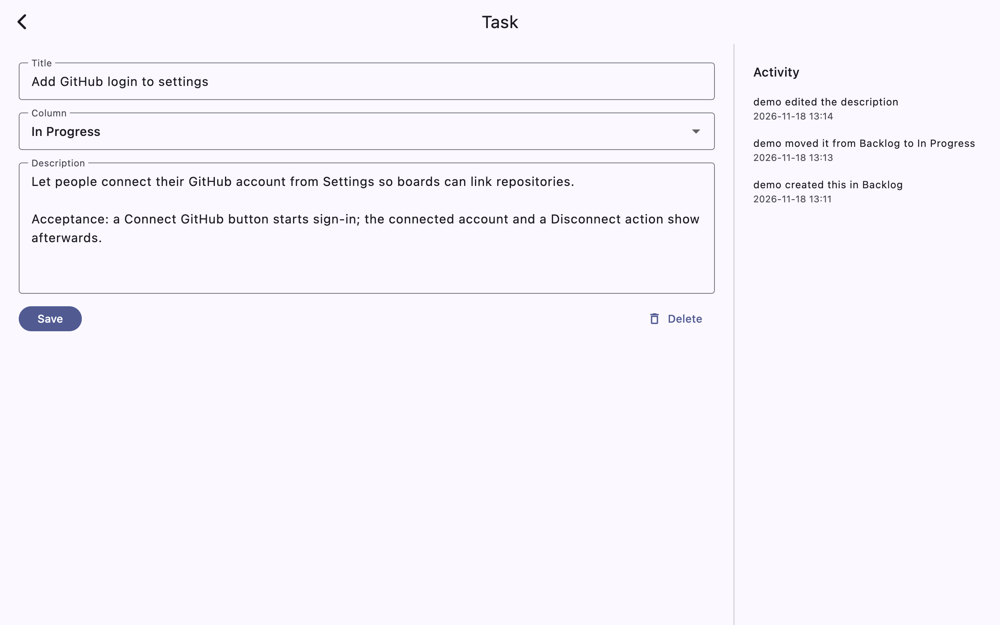
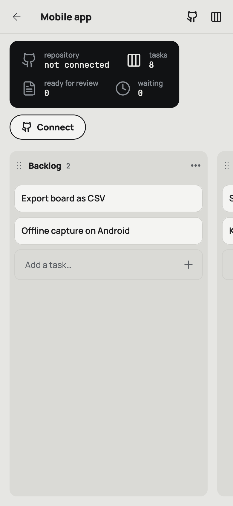
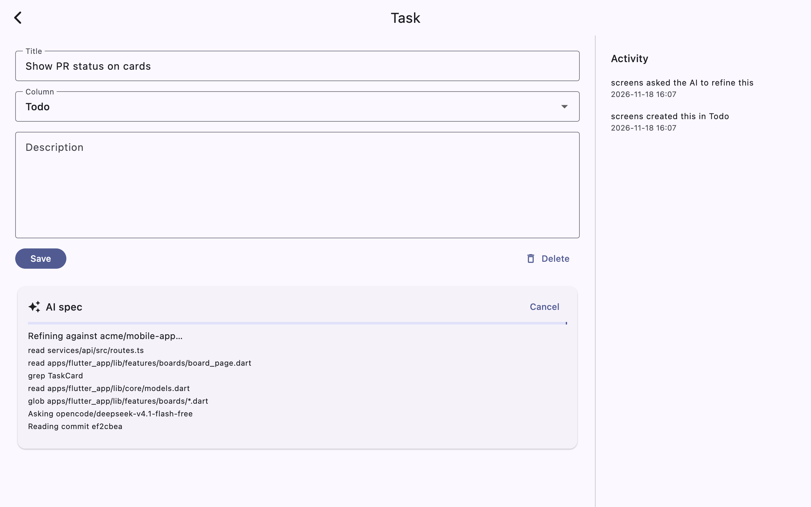
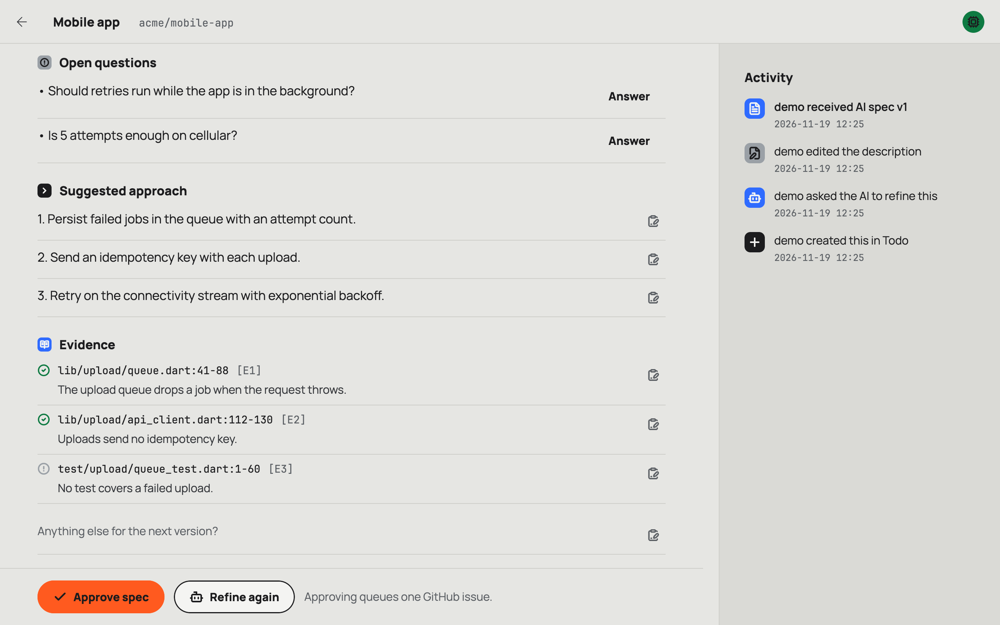
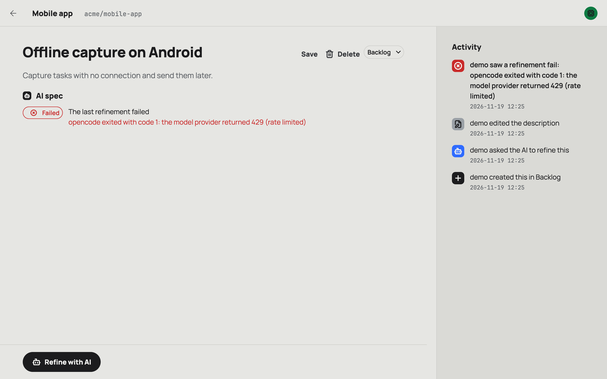
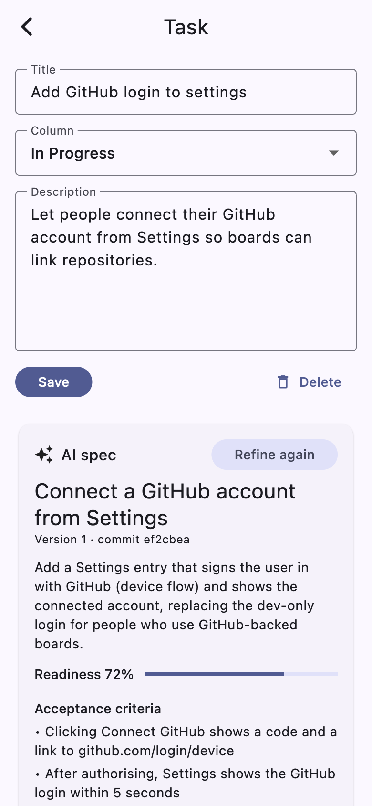

# AI GitHub Kanban

AI-native Kanban for GitHub that turns a short task brief into a detailed, repository-grounded spec. Flutter client,
TypeScript backend and workers, OpenCode + DeepSeek agents.

<picture>
  <source media="(prefers-color-scheme: dark)" srcset="docs/architecture/structure-dark.png">
  
</picture>

## What it is

A project board that does the spec-writing legwork. Capture a five-word task on your phone; an agent reads your
repository on your own Mac and turns the brief into a detailed spec: requirements, acceptance criteria,
the files and code it's grounded in, open questions, and a suggested approach. Once you approve, it opens exactly one
GitHub issue. PRs that people link to that issue, with their reviews and CI status, flow back onto the card.

**It doesn't write or run code.** Agents only read the repository; implementation stays with you and your team.

The core design choice is keeping two things apart:

- **Project management**: boards, tasks, approvals. Lives in the central backend, independent of any client.
- **AI reasoning**: refining a brief into a spec. Runs on a worker with read-only repository access.

## Preview

What milestones 1–2 deliver: the board, quick capture and task history, here on macOS against the local API.
Milestone 3 adds AI refinement with a local worker (screenshots further down). Milestone 4 files the approved spec as a
GitHub issue and follows the PRs linked to it; it runs once you register a GitHub App (see below). Milestone 5 lets you pair
your own machine as a worker from the app, keeps it running in the background, and retries runs a vanished worker
left behind.


[Watch the demo as MP4](docs/media/demo.mp4)

| Board | Task with its history | Phone width |
| --- | --- | --- |
|  |  |  |

### AI refinement (Milestone 3)

A board connected to a repository, with cards in each refinement state, and the task page following a run and
showing its spec. The run progress and spec here are sample data posted by a test worker, not real model output.

| Board with refinement status | Run in progress | Spec ready for review |
| --- | --- | --- |
|  |  |  |

| Evidence and approval | Failed run | Spec at phone width |
| --- | --- | --- |
|  |  |  |

## Surfaces

| Surface | Role |
| --- | --- |
| Desktop (macOS, Windows, Linux) | Full workspace, plus the local worker |
| Web | Project management |
| Mobile (iOS, Android) | Task capture, spec approval, agent monitoring, PR notifications |

All three are one Flutter app with adaptive layouts.

## How a task flows

1. **Capture**: the app saves the task and submits it with an idempotency key, so retries never duplicate a card.
2. **Refine**: the orchestrator leases a refinement job to a worker of whoever connected the board's repository, on
   their own machine (there is no hosted worker). OpenCode with DeepSeek, or optionally Claude Code, reads a pinned commit and returns a versioned spec with evidence and open questions.
3. **Approve**: you review the spec, comment on any of its items (an answer, for an open question) and send the
   comments back for a revised version, or approve it; approval files one GitHub issue through the GitHub App, or, for
   a card imported from an issue, posts the spec on that issue as a comment.
4. **Track**: GitHub webhooks are verified, deduplicated and reconciled; GitHub's review decision and CI status land on
   the card (the app refreshes while issues are queued or open; SSE later).
   Your column choice stays yours, separate from GitHub's status.

## Principles

- **The backend is the source of truth** for tasks, specs, agent runs and board history.
- **GitHub stays authoritative** for issues, PRs, reviews and CI.
- **Agents are read-only.** They read, list and search the repository; edits, shell commands and Git writes are denied,
  and repository content is treated as data, never as instructions.
- **Jobs are recoverable.** Worker leases mean a dropped connection never produces two specs for one refinement, approval
  never creates a second issue, and a running job is never silently moved between workers.
- **No secrets in clients.** Model and GitHub credentials stay on workers or the backend.

## Stack

| Part | Choice |
| --- | --- |
| Client | Flutter, Riverpod, GoRouter, Dio, Drift |
| Backend | TypeScript, Fastify, PostgreSQL (also the job queue for now) |
| Workers | TypeScript daemon on your own machine (a macOS LaunchAgent), paired from the app |
| Agents | OpenCode SDK; OpenCode's free DeepSeek V4.1 Flash by default, paid DeepSeek API or Claude Code optional |
| GitHub | GitHub App, REST/GraphQL, webhooks |
| Telemetry | OpenTelemetry |

## Status

Early build. Milestones: foundation → Kanban core → OpenCode + DeepSeek refinement → GitHub sync → your own workers →
hardening. The first release targets macOS desktop and web.

Architecture: [docs/architecture/overview.md](docs/architecture/overview.md)

## Local development

Requires Docker, Node 24+ and Flutter via fvm (`apps/flutter_app/.fvmrc` pins the version).

```sh
docker compose up -d --wait                  # Postgres on localhost:55432 (dev db `kanban`, test db `kanban_test`)

cd services/api
npm install
npm test                                     # API tests against kanban_test
npm run dev                                  # API on http://localhost:8080, migrations run on start

cd apps/flutter_app
fvm flutter run -d macos                     # or: -d chrome
fvm flutter test integration_test/board_flow_test.dart -d macos        # end-to-end flow against the running API
fvm flutter test integration_test/refinement_flow_test.dart -d macos   # refinement UI, with the test playing the worker
```

`apps/flutter_app/tool/acceptance.sh` runs both end-to-end flows in one go (macOS): it starts Postgres, reuses an API
already on `:8080` (started with `npm run dev`) or starts one for the run, then drives the app. It's local only; CI runs lint (`npm run lint` at the
repo root), `dart format`, the analyzer, and the unit and API tests.

### Refining tasks with a local worker

The worker reads repositories already checked out on your machine and needs the `opencode` CLI installed (or Claude Code, if you choose it as the refiner). It uses
OpenCode's free `opencode/deepseek-v4.1-flash-free` (add fallbacks to `models` in `worker.json`; `opencode models
opencode` lists what's available); repository code is sent to that provider. The free tier has a usage limit: once it's used up, runs fail with "Free limit reached"
until it resets, or you set paid models in `worker.json`.

```sh
cd services/worker
npm install
npm test
npm run setup -- <code>                         # the code from the app's Workers page: connect, pick checkouts, install the service
```

`setup` is three steps you can also run alone: `npm run connect -- <code>` (saves `~/.config/ai-kanban/worker.json`),
`npm run checkouts` (pick repositories from Orca's list, or `npm run allow -- owner/name ~/code/name`) and
`npm run service -- install` (macOS LaunchAgent; or `npm start` to run it in a terminal). `npm run mcp` serves approved specs
to your coding agent over MCP.

Pairing, the background service, the Claude Code option and troubleshooting: [docs/setup/worker.md](docs/setup/worker.md).

With `"claudeInOrca": true` next to `"refiner": "claude"` in `worker.json`, each run also shows its progress in a
terminal of the Orca app, titled after the card, in the checkout's Orca workspace. Claude Code itself still runs under
the worker with the same restrictions, and runs go ahead without the terminal when Orca is closed. Only the local Orca
app is supported, not remote Orca environments.

In the app, connect the board to the same `owner/name` (the link icon on the board). Every new card on that board is
then refined, by your worker, including cards teammates add (connecting a repository shares your checkout of it with
that board). The task page shows the run live and the resulting spec, which you can approve or refine again. The
agent reads a copy of the checkout's current commit, so untracked files such as `.env`, `.git` and uncommitted changes
never reach it. It can only read, list, glob and grep there, and ignores the repository's own OpenCode config,
`AGENTS.md` and plugins, as well as your personal OpenCode setup. Models are set in `worker.json`.

### GitHub issues and pull requests

Approving a spec queues one GitHub issue, filed by a GitHub App from the spec. PRs that close that issue ("Closes #12",
or linked in the PR's Development sidebar, which shows with the PR's next update) or whose branch in the repository
starts with `12-` show on the card and the task page with GitHub's review decision and CI status. Register a development app and a webhook tunnel with
[docs/setup/github-app.md](docs/setup/github-app.md); without it the API logs `GitHub sync off` and issues stay
queued. Webhooks arrive on a separate port (8081) so the tunnel exposes nothing else. With `AUTH_MODE=github`,
pointing a board at a repository, listing or importing its issues, approving a spec into it and retrying a filing all
need write access to that repository on GitHub. In `AUTH_MODE=dev` none of that is checked, so keep a dev API on
localhost.

**Import GitHub issue** (the board's repository menu) lists the repository's open issues and makes a card from the one
you pick; each issue can be a card on one board only. The card is refined like any other, and approving its spec posts
the spec as one comment on the issue (approving a later version edits that comment). GitHub keeps owning the issue's
title and body. Mind that an imported issue's text becomes the Refiner's brief, so anyone who can open issues on the
repository writes briefs for it; the Refiner stays read-only either way.

To regenerate the screenshots and demo in `docs/media`, keep the API running and run
`apps/flutter_app/tool/readme_media.sh` (macOS; drives the app with a `demo` account and needs ffmpeg).

`npm run dev` starts the API with `AUTH_MODE=dev`: passwordless sign-in by login name, loopback only, refused when
`NODE_ENV=production`. `AUTH_MODE=github` signs in with GitHub instead (Device Flow: the app shows a code to enter at
github.com/login/device) and needs the GitHub App configured. Dev accounts don't carry over: their sessions and
workers stop working, and a GitHub account with the same login starts fresh. No GitHub token is kept: it is used once to learn who you are. To serve
the web build from another origin, list it in `CORS_ORIGINS` (comma-separated). The app reaches the API at `http://localhost:8080`; override
with `--dart-define=API_URL=...` (an Android emulator needs `http://10.0.2.2:8080`). The Flutter build contains no secrets.
