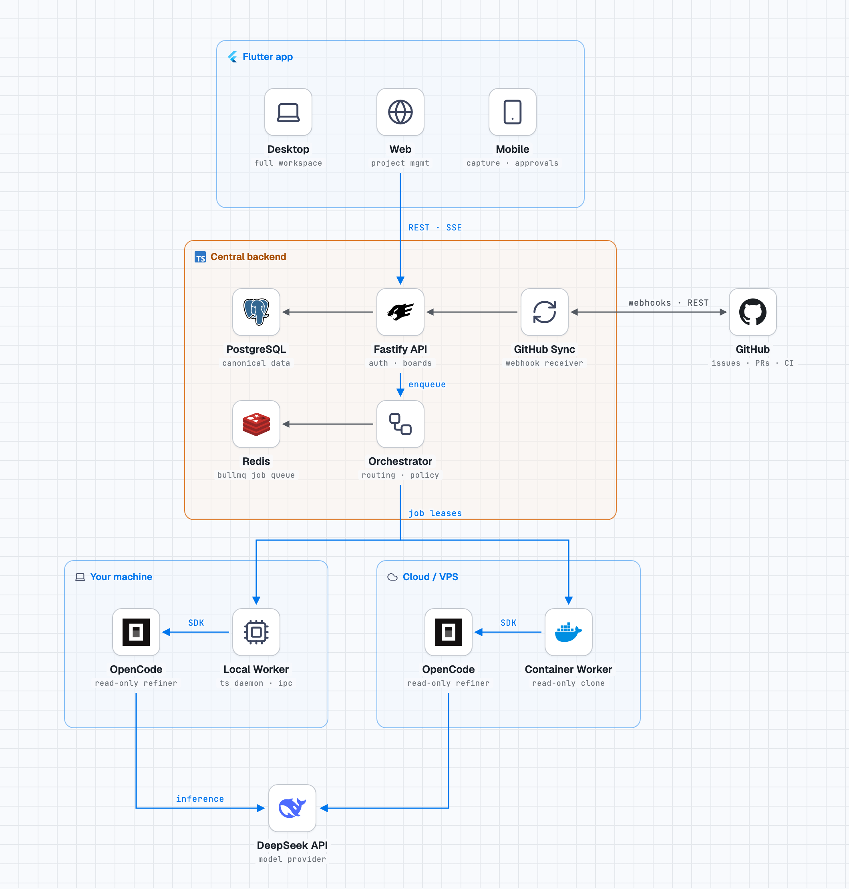

# AI GitHub Kanban

AI-native Kanban for GitHub that turns a short task brief into a detailed, repository-grounded spec. Flutter client,
TypeScript backend and workers, OpenCode + DeepSeek agents.

<picture>
  <source media="(prefers-color-scheme: dark)" srcset="docs/architecture/structure-dark.png">
  
</picture>

## What it is

A project board that does the spec-writing legwork. Capture a five-word task on your phone; an agent reads your
repository on your Mac or a cloud worker and turns the brief into a detailed spec: requirements, acceptance criteria,
the files and code it's grounded in, open questions, and a suggested approach. Once you approve, it opens exactly one
GitHub issue. PRs that people link to that issue, with their reviews and CI status, flow back onto the card.

**It doesn't write or run code.** Agents only read the repository; implementation stays with you and your team.

The core design choice is keeping two things apart:

- **Project management**: boards, tasks, approvals. Lives in the central backend, independent of any client.
- **AI reasoning**: refining a brief into a spec. Runs on a worker with read-only repository access.

## Surfaces

| Surface | Role |
| --- | --- |
| Desktop (macOS, Windows, Linux) | Full workspace, plus the local worker |
| Web | Project management |
| Mobile (iOS, Android) | Task capture, spec approval, agent monitoring, PR notifications |

All three are one Flutter app with adaptive layouts.

## How a task flows

1. **Capture**: the app saves the task and submits it with an idempotency key, so retries never duplicate a card.
2. **Refine**: the orchestrator leases a refinement job to a healthy worker (local first, cloud if policy allows).
   OpenCode with DeepSeek reads a pinned commit and returns a versioned spec with evidence and open questions.
3. **Approve**: you review the spec, answer its open questions or ask for another pass; approval creates one GitHub
   issue through the GitHub App.
4. **Track**: GitHub webhooks are verified, deduplicated and reconciled; reviews and CI land on the card over SSE.
   Your column choice stays yours, separate from GitHub's status.

## Principles

- **The backend is the source of truth** for tasks, specs, agent runs and board history.
- **GitHub stays authoritative** for issues, PRs, reviews and CI.
- **Agents are read-only.** They read, list and search the repository; edits, shell commands and Git writes are denied,
  and repository content is treated as data, never as instructions.
- **Jobs are recoverable.** Worker leases mean a dropped connection never runs the same refinement twice, approval
  never creates a second issue, and a running job is never silently moved between workers.
- **No secrets in clients.** Model and GitHub credentials stay on workers or the backend.

## Stack

| Part | Choice |
| --- | --- |
| Client | Flutter, Riverpod, GoRouter, Dio, Drift |
| Backend | TypeScript, Fastify, PostgreSQL, BullMQ on Redis |
| Workers | TypeScript daemon (local) and containers (cloud), same read-only agent contract |
| Agents | OpenCode SDK; DeepSeek Flash by default |
| GitHub | GitHub App, REST/GraphQL, webhooks |
| Telemetry | OpenTelemetry |

## Status

Early build. Milestones: foundation → Kanban core → OpenCode + DeepSeek refinement → GitHub sync → hybrid workers →
hardening. The first release targets macOS desktop and web.

Architecture: [docs/architecture/overview.md](docs/architecture/overview.md)
